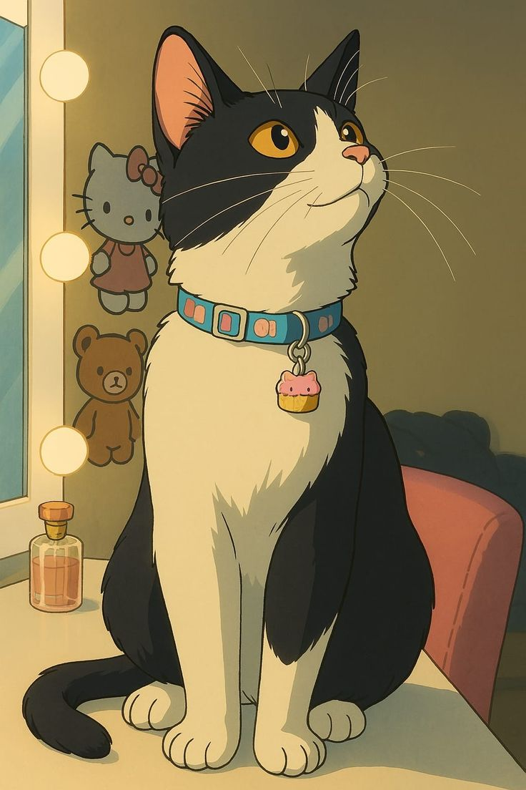

### ฅ^•ﻌ•^ฅ　about me

- 🌸 **backend engineer & security researcher**
- ⚡ secure services at **100,000+ req/s** in Go & Rust
- 🐾 ran a **privacy-first VPS hosting company at 16**: racks, Proxmox, BGP, the whole thing
- 🍡 found a **critical XSS on SIH 2025** → acknowledged by **NPCI**
- 📖 published *"Vulnerabilities in IoT Device Clusters"* with **CRC Press**
- 🏆 two-time **SIH internal** winner
- 🌏 40+ international clients · Kolkata

 

### (=^･ω･^=)　toolbox

🎀 **sec** · pentest · SIEM · IR · OWASP · threat modeling · CTFs 
🎀 **net** · BGP · IPv6 · eBPF · XDP · DPDK · zero-copy 
🎀 **infra** · Proxmox · Grafana · Prometheus · Nginx · CI/CD

 

### ／ᐠ｡ꞈ｡ᐟ＼　things i made

 
<i>me, reverse engineering something i probably shouldn't (◔◡◔)</i>

| | project | made with | what it does ♡ |
|:-:|:--|:--|:--|
| 🌐 | **[ReverseLLMs](https://reversellms.com)** | `Go` `Next.js` `Mongo` | one REST API over many AI web UIs, swap providers mid-chat *(private)* |
| 📞 | **Vartalap** | `Go` `Twilio` `LLM` | AI helper over a plain phone call / SMS, no internet needed *(private)* |
| 🛡️ | **[XFW](https://github.com/0dev1337/xfw)** | `Rust` `eBPF` | lil firewall that drops packets at the XDP hook |
| 🎵 | **[SpotifyDL](https://github.com/0dev1337/SpotifyDL)** | `Go` `TUI` | playlist → 320 kbps MP3s with cover art |
| 🗃️ | **[TmpVault](https://tmpvault.com)** | `Next.js` `Go` | anonymous 1 GB file host with auto-expiry |
| 🧪 | **lab** | | [`checkhost`](https://github.com/0dev1337/checkhost-backend) · [`cpanelscanner`](https://github.com/0dev1337/cpanelscanner) · [`AntiCloudflareWAF`](https://github.com/0dev1337/AntiCloudflareWAF) · [`CardGame`](https://github.com/0dev1337/CardGame) |

### (ﾉ◕ヮ◕)ﾉ*:･ﾟ✧　stats

 
<i>me when prod goes down at 3 am (╥﹏╥)</i>

### ฅ(^・ω・^ฅ)　repo guardians

&nbsp;&nbsp;
 
<i>they review every PR. they approve none.</i>

💌 [zero@zerodev.me](mailto:zero@zerodev.me)　·　🔐 PGP `ED02 4FC2 7387 0261 24D9 A95A 73BC E49F 77ED A3FC`

*i have many private repos >_<*　ありがとう for visiting ✌ ♡

